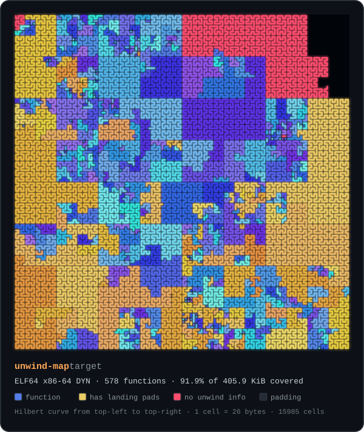

# unwind-map

[](https://github.com/sheratonc/unwind-map/actions/workflows/ci.yml)


**Recover function boundaries from stripped Linux ELF binaries, using the unwind tables that `strip` can't remove.**

`strip` deletes a binary's symbol table, but it has to leave `.eh_frame` alone: C++ exceptions, Rust panics, `backtrace(3)`, profilers and debuggers all need it at run time. Every Frame Description Entry in that table records the exact start and end of one function. `unwind-map` decodes those entries and gives you a function map of the stripped binary: exact boundaries, no disassembly heuristics, in milliseconds.

<p align="center">
  
</p>

## Why this works

Compilers emit an FDE for every function by default on x86-64 and AArch64 Linux (`-fasynchronous-unwind-tables`), including `static` functions that never had an exported name. The table is part of the loaded image, so removing it breaks exception handling and backtraces. That is why `strip`, `sstrip` and most packers leave it in place.

Compared with disassembly-based function discovery (prologue matching, recursive descent from the entry point), unwind tables give:

- **Exact end addresses.** The compiler recorded the range; nothing is inferred.
- **No false starts.** Every entry corresponds to code the compiler emitted as a function.
- **Functions that are only reached indirectly.** Callbacks, vtable targets and dispatch tables are found without following any calls.
- **Exception-handling metadata.** Functions with landing pads (C++ `catch` blocks, destructors that run during unwinding, Rust panic cleanups) are flagged.

## See a binary

`--format svg` draws the executable code as a map. Bytes are laid out along a Hilbert curve, which keeps nearby addresses next to each other, so every recovered function becomes one connected trace:

<p align="center">
  
</p>

This is `unwind-map` itself: a stripped x86-64 static-pie build. Gold traces are functions with landing pads (Rust panic cleanups), and the red block is musl libc, compiled without unwind tables. Open the SVG directly to get a tooltip with the name, range and size of every function.

```sh
unwind-map --format svg ./app > app-map.svg
```

## Features

- **ELF32 and ELF64, little-endian.** Tested on x86-64, x86 and AArch64 executables and PIEs.
- **Survives missing or damaged section headers.** Falls back to `PT_GNU_EH_FRAME` → `.eh_frame_hdr` and walks its binary search table, so `sstrip`ped or tampered binaries still work.
- **Names whatever it can.** Sources are `.symtab`, `.dynsym` (exported functions survive stripping), linker stub sections such as `.plt`, and the ELF entry point (`entry`). Everything else becomes `sub_<address>`.
- **Flags** functions with an LSDA (`L`), a personality routine (`P`) and signal frames (`S`).
- **`--gaps`** reports executable code that has no unwind info and isn't alignment padding: hand-written assembly, code built with `-fno-asynchronous-unwind-tables`, or bytes that were patched in later.
- **Output formats:** a colored terminal table, CSV, JSON, `nm`-style lines, Ghidra symbol import, `objcopy` arguments that put the symbols back into the binary, and an SVG map of the code.
- **`--base`** rebases every address into Ghidra's, GDB's or a live process's address space.
- **Self-contained:** about 2,700 lines of std-only Rust with zero dependencies. It reads files and never executes them, so it runs on Linux, macOS and Windows.

## Install

```sh
cargo install --git https://github.com/sheratonc/unwind-map
```

or build from a clone with `cargo build --release`.

## Usage

```text
unwind-map [OPTIONS] <FILE>

  -f, --format <FORMAT>  Output format: text (default), csv, json, nm, ghidra, objcopy, svg
  -g, --gaps             Also list executable code that has no unwind info and is not padding
  -b, --base <ADDR>      Print addresses as if the image were loaded at ADDR
                         (e.g. 0x100000 for Ghidra, or a base from /proc/<pid>/maps)
      --ignore-sections  Ignore section headers; locate unwind data via PT_GNU_EH_FRAME only
  -u, --unnamed-only     Only list functions that have no symbol name
      --color <WHEN>     Color text output: auto (default), always, never
  -q, --quiet            Do not print warnings
```

Text output is colored only when stdout is a terminal, and `NO_COLOR` is honoured. Exit status is `0` on success, `1` if the file cannot be analysed, and `2` for usage errors. Warnings about malformed records go to stderr; data goes to stdout.

### Put symbols back into a stripped binary

```sh
unwind-map --format objcopy ./app > syms.txt
objcopy @syms.txt ./app ./app.sym     # llvm-objcopy works too
gdb ./app.sym                         # break sub_4011a0, readable backtraces, objdump -d with labels
```

Each line is a section-relative `--add-symbol name=.text:0x…,function,…` argument, so the result is a normal ELF symbol table that any tool can read.

### Import into Ghidra

```sh
unwind-map --format ghidra --base 0x100000 ./app > app-functions.txt
```

Open Script Manager, run the bundled `ImportSymbolsScript.py` and pick the file. Ghidra loads position-independent ELF files at `0x100000` by default; leave out `--base` for non-PIE (`EXEC`) binaries. Seeding the exact function starts before auto-analysis helps the most on binaries that use a lot of indirect calls.

### Match a running process

```sh
base=0x$(grep -m1 "$(readlink -f ./app)" /proc/"$(pidof app)"/maps | cut -d- -f1)
unwind-map --base "$base" --format nm ./app
```

The addresses now line up with what `gdb -p`, `perf` and crash backtraces show for that process.

### Find code that has no unwind info

```console
$ unwind-map --gaps ./unwind-map-unstripped
...
uncovered code (no unwind info, not padding):
START               END                     SIZE  SECTION     SYMBOL
0x0000000000017d00  0x0000000000017d12        18  .text       entry
0x0000000000017d16  0x0000000000017ef0       474  .text       _start_c
0x0000000000017ef0  0x0000000000017f13        35  .text       __dls2
0x000000000006a87b  0x000000000006a8cd        82  .text       unw_getcontext
0x00000000000761ff  0x000000000007625c        93  .text       __libunwind_Registers_x86_64_jumpto
0x000000000007625c  0x0000000000076423       455  .text       sysconf
...
```

When symbols are available, each function gets its own row. In a stripped binary, neighbouring functions merge into one region. Alignment padding (multi-byte NOPs, `int3` fill, zero fill, AArch64 `nop` words) is never reported.

## How it works

```text
ELF header
 ├─ section headers ──────────► .eh_frame ─────────────────────────────┐   sequential walk
 └─ PT_GNU_EH_FRAME ─► .eh_frame_hdr ─► binary search table ─► FDEs ───┤   (no section headers needed)
                                                                       ▼
          CIE: version, augmentation ("zR", "zPLR", ...), pointer encodings
          FDE: pc_begin / pc_range decoded per DW_EH_PE_* (pcrel, datarel, sdata4, udata8, ...)
                                                                       ▼
          keep FDEs that start in executable code, are non-empty and unique
                                                                       ▼
          name: .symtab › .dynsym › stub section › entry point › sub_<addr>
                                                                       ▼
          coverage per executable section; uncovered bytes minus padding = --gaps
```

The decoder follows the LSB "Exception Frames" format, including 64-bit extended lengths, CIE versions 1/3/4, the `z`/`R`/`P`/`L`/`S` augmentations, AArch64's `B`/`G` augmentations, and libgcc's rule that a raw zero pointer means "none". Malformed records produce a warning and are skipped, and parsing never panics on hostile input.

## Accuracy

[`ci/accuracy.py`](ci/accuracy.py) strips a binary, runs `unwind-map` on the stripped copy, and checks the result against the unstripped original and against an independent `.eh_frame` decoder (`readelf --debug-dump=frames`, or `llvm-readobj --unwind`):

| Binary (Rust, static-pie, musl) | Arch | Functions with an FDE | Recovered | False starts | No-CFI functions found by `--gaps` |
|---|---|--:|--:|--:|--:|
| `unwind-map` itself | x86-64 | 578 | 578 | 0 | 129 / 129 |
| `unwind-map` itself | x86 | 578 | 578 | 0 | 133 / 133 |
| `unwind-map` itself | AArch64 | 668 | 668 | 0 | 130 / 130 |

Every recovered range matches the reference decoder exactly. The functions without an FDE are musl libc and libunwind assembly, because musl is compiled without unwind tables, and all of them show up in `--gaps`. The same map comes back with the section header table removed, and an `objcopy` round trip reproduces every symbol.

On every push, CI runs the same checks against a C and a C++ corpus (`ci/corpus/`) built with GCC and Clang at `-O0`/`-O2`, both PIE and non-PIE. The C++ corpus covers exceptions, cleanups and templates. To reproduce:

```sh
python3 ci/accuracy.py corpus  target/release/unwind-map                 # needs gcc/clang + binutils
python3 ci/accuracy.py compare target/release/unwind-map ./unstripped-binary ...
```

## Limitations

- Functions only show up if they have unwind info. Code built with `-fno-asynchronous-unwind-tables` (common for libcs, kernels and firmware) and hand-written assembly have none; `--gaps` shows where that code is.
- `.debug_frame` is not read yet. 32-bit ARM, which uses `.ARM.exidx` instead of `.eh_frame`, is not supported, and neither are big-endian targets.
- PLT stubs appear as a single `.plt` region (when the linker emits an FDE for it) rather than one entry per import.
- Names are printed as stored; pipe through `c++filt` or `rustfilt` to demangle.

## Roadmap

- `.debug_frame` and `.ARM.exidx` as additional sources
- Per-import PLT stub names from `.rela.plt`
- Stack frame size per function, from the CFA rules in each FDE
- Big-endian targets (PowerPC64, s390x, MIPS)

## Development

```sh
cargo test                     # unit tests + fixtures for x86-64, x86 and AArch64
cargo clippy --all-targets -- -D warnings
tests/fixtures/build.sh        # rebuild the fixtures (needs only rustup; see the script)
python3 docs/make_demo.py > docs/demo.svg   # re-render the terminal demo from docs/demo-transcript.txt
```

The fixtures are tiny freestanding programs, cross-linked with `rust-lld` for each architecture. Each one includes a hand-written assembly function with no CFI, so the gap detection is tested too.

## See also

`unwind-map` is the Linux counterpart to my Windows tools. [rtti-dump](https://github.com/sheratonc/rtti-dump) and [vtable-dump](https://github.com/sheratonc/vtable-dump) recover C++ class structure from MSVC binaries in the same spirit: they read metadata the compiler had to leave in the binary instead of guessing.

## License

[MIT](LICENSE)
